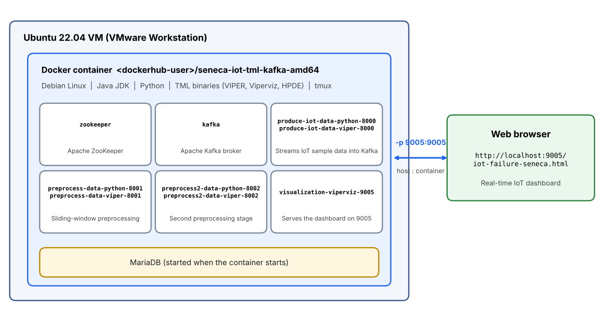

# Docker TML Dashboard: Kafka, MariaDB and tmux for Real-Time IoT Monitoring
A hands-on containers lab that runs a **Transactional Machine Learning (TML)** solution in **Docker** on an **Ubuntu 22.04 virtual machine**. A single container bundles **Apache Kafka**, **MariaDB**, **Python** and the TML binaries, runs each service in its own **tmux** session, and serves a **real-time IoT failure-prediction dashboard** on port **9005**. The lab covers the pre-built image, building and pushing your own image to **Docker Hub**, and inspecting the running container from the inside.


**Last updated:** November 2026

---

## 📚 Project Objectives
- Install **Docker** on an Ubuntu VM and verify it with `hello-world`
- Pull and run the pre-built TML image with **port forwarding** (host `9005` to container `9005`)
- Open the **real-time IoT dashboard** in a browser and start streaming
- Build your own TML image from the upstream Dockerfile and push it to **Docker Hub** under your own ID
- Run your image and confirm the dashboard shows device performance and failure prediction
- Use `docker ps` and `docker exec` to go inside the running container
- List the **tmux** sessions for Kafka, ZooKeeper and the TML scripts, attach to the visualization session, then detach and exit cleanly

---

## 🗺️ Architecture


---

## 📂 Repository Layout
```
Docker-TML-Kafka-IoT-Real-Time-Dashboard/
├── diagrams/
│   └── architecture.png             # VM, container, tmux sessions and port forwarding
├── docs/
│   ├── architecture.md              # Components, ports and design notes
│   ├── setup.md                     # Step-by-step build guide
│   ├── verification.md              # Every check, with expected output
│   └── submission.md                # Project summary and references
├── screenshots/                     # Proof of each deliverable
├── scripts/
│   ├── install-docker.bash          # Install Docker and run hello-world
│   ├── run-tml-dashboard.bash       # Pull and run the container, print the dashboard URL
│   ├── build-container.bash         # Build (and optionally push) your own image
│   └── verify-container.bash        # Optional helper to run the checks
├── .gitignore
└── README.md
```

---

## 🧰 Requirements
- Ubuntu 22.04 VM (built in VMware Workstation) with internet access
- A free **Docker Hub** account
- `docker.io` and `docker-compose` (installed in the steps below)
- A web browser on the VM (Firefox or Chrome)
- A free **GitHub** account, to import the upstream `raspberrypi` repository
- About 5 GB of free disk space for the image (the pushed repository showed 4.2 GB)

---

## ⚙️ Setup

Full walkthrough: [docs/setup.md](docs/setup.md). The short version:

1. Install Docker and let your user reach the socket:

   ```bash
   sudo apt-get update
   sudo apt-get install -y docker.io docker-compose
   sudo chmod 666 /var/run/docker.sock
   docker run hello-world
   ```

   If a pull fails with `no such file or directory`, run `sudo systemctl restart docker` and try again.

2. Pull and run the pre-built image, forwarding host port 9005 to container port 9005:

   ```bash
   docker pull maadsdocker/seneca-iot-tml-kafka-amd64
   docker run -p 9005:9005 maadsdocker/seneca-iot-tml-kafka-amd64
   ```

3. Open the dashboard in a browser on the VM and press **START STREAMING** (data can take a few minutes to appear):

   ```
   http://localhost:9005/iot-failure-seneca.html?topic=iot-preprocess2,iotpreprocess&offset=-1&groupid=&rollbackoffset=500&topictype=prediction&append=0&secure=1
   ```

4. Build your own image. Copy the upstream [Dockerfile](https://github.com/smaurice101/raspberrypi/blob/main/docker/Dockerfile) into an empty folder, then build with your Docker Hub ID:

   ```bash
   # First build, from scratch (about 20 minutes)
   docker build -t <dockerhub-username>/seneca-iot-tml-kafka-amd64 \
     --build-arg CHIP=AMD64 --no-cache --network=host .

   # Later builds, reusing cached layers (about 5 minutes)
   docker build -t <dockerhub-username>/seneca-iot-tml-kafka-amd64 \
     --build-arg CHIP=AMD64 --build-arg CACHEBUST=$(date +%s) --network=host .
   ```

5. Push the image to Docker Hub and run it:

   ```bash
   docker login
   docker push <dockerhub-username>/seneca-iot-tml-kafka-amd64:latest
   docker run -p 9005:9005 <dockerhub-username>/seneca-iot-tml-kafka-amd64
   ```

6. In a second terminal, go inside the running container:

   ```bash
   docker ps
   docker exec -it <container-id> bash
   ls
   tmux ls
   tmux a -t visualization-viperviz-9005     # detach with Ctrl+b, then d
   exit
   ```

---

## 🐳 Container Contents

The image is built from the upstream `smaurice101/raspberrypi` project. Inside the container:

| Item | Purpose |
|------|---------|
| Debian Linux | Base operating system |
| Apache Kafka and ZooKeeper | Message streaming for the IoT data |
| MariaDB | Database server (starts with the container) |
| TML binaries (VIPER, Viperviz, HPDE) | Real-time processing and visualization |
| Python scripts | Produce and preprocess the IoT data |
| tmux | Runs each service in its own named session |
| Java JDK | Required by Kafka |

---

## ✅ Usage & Verification

Every check below has expected output and a screenshot in [docs/verification.md](docs/verification.md).

**Run the container**

```
$ sudo docker run -p 9005:9005 <dockerhub-username>/seneca-iot-tml-kafka-amd64
Stopping MariaDB database server: mariadbd.
Starting MariaDB database server: mariadbd.
```

**List the container**

```
$ docker ps
CONTAINER ID   IMAGE                                    COMMAND                  STATUS         PORTS
9b4c8c435ec6   <dockerhub-username>/seneca-iot-tml-…    "/bin/bash -c 'while…"   Up 8 minutes   0.0.0.0:9005->9005/tcp, :::9005->9005/tcp
```

**Inside the container**

```
root@9b4c8c435ec6:/# ls
Hpde          Kafka  Viper-preprocess   Viperviz  boot  dev  home  lib64  mnt  proc  run  srv  tmp  usr
IotSolution   Viper-preprocess2  Viper-produce  bin  deploy  etc  lib  media  opt  root  sbin  sys  tmux  var
```

```
root@9b4c8c435ec6:/# tmux ls
kafka: 1 windows
preprocess-data-python-8001: 1 windows
preprocess-data-viper-8001: 1 windows
preprocess2-data-python-8002: 1 windows
preprocess2-data-viper-8002: 1 windows
produce-iot-data-python-8000: 1 windows
produce-iot-data-viper-8000: 1 windows
visualization-viperviz-9005: 1 windows
zookeeper: 1 windows
```

**Dashboard** – the page shows the average failure risk, the number of Kafka messages processed, the potential failure issues found and a real-time risk map.

---

## 🔍 How It Works
1. **One container, many services** – The image starts Kafka, ZooKeeper, MariaDB and the TML scripts together, and each service runs in its own tmux session.
2. **Port forwarding** – `-p 9005:9005` publishes container port 9005 on the VM, so the browser reaches the dashboard at `localhost:9005`.
3. **Data flow** – The `produce-iot-data` scripts write IoT readings to Kafka topics, the two `preprocess` stages process them in sliding time windows, and the `visualization-viperviz-9005` session serves the dashboard that reads the results.
4. **Prediction** – The dashboard URL reads the `iot-preprocess2` and `iotpreprocess` topics with `topictype=prediction`, and shows the failure risk per device.
5. **Your own image** – The build takes the upstream Dockerfile and your Docker Hub ID, so the image is tagged and pushed under your account.
6. **Faster rebuilds** – Replacing `--no-cache` with `CACHEBUST=$(date +%s)` reuses cached layers, which cuts the build from about 20 minutes to about 5.
7. **Inspecting the container** – `docker exec -it <id> bash` opens a shell inside it, `tmux ls` lists the services, and `tmux a -t <name>` attaches to a session. `Ctrl+b` then `d` detaches without stopping it.

---

## 🖼️ Screenshots
| # | Screenshot | File |
|---|------------|------|
| 1 | Docker Hub repository and image push | [01-docker-hub-repository-and-push.png](screenshots/01-docker-hub-repository-and-push.png) |
| 2 | Dashboard streaming in the browser | [02-dashboard-streaming-in-browser.png](screenshots/02-dashboard-streaming-in-browser.png) |
| 3 | `docker run` with port forwarding, MariaDB starting | [03-docker-run-container-mariadb-start.png](screenshots/03-docker-run-container-mariadb-start.png) |
| 4 | `docker ps` | [04-docker-ps-running-container.png](screenshots/04-docker-ps-running-container.png) |
| 5 | `docker exec` and `ls` inside the container | [05-docker-exec-container-ls.png](screenshots/05-docker-exec-container-ls.png) |
| 6 | `tmux ls` | [06-tmux-ls-sessions.png](screenshots/06-tmux-ls-sessions.png) |
| 7 | `tmux a -t visualization-viperviz-9005` | [07-tmux-attach-viperviz-9005.png](screenshots/07-tmux-attach-viperviz-9005.png) |
| 8 | Detach from the tmux session | [08-tmux-detach-session.png](screenshots/08-tmux-detach-session.png) |
| 9 | Exit the container | [09-exit-container.png](screenshots/09-exit-container.png) |

---

## 📖 References
- [Docker Hub](https://hub.docker.com/)
- [smaurice101/raspberrypi – docker folder](https://github.com/smaurice101/raspberrypi/tree/main/docker)
- [smaurice101/raspberrypi – Dockerfile](https://github.com/smaurice101/raspberrypi/blob/main/docker/Dockerfile)
- [smaurice101/raspberrypi – repository](https://github.com/smaurice101/raspberrypi)
- [MAADSTML Python library](https://pypi.org/project/maadstml/)
- [Transactional Machine Learning binaries](https://github.com/smaurice101/transactionalmachinelearning)
