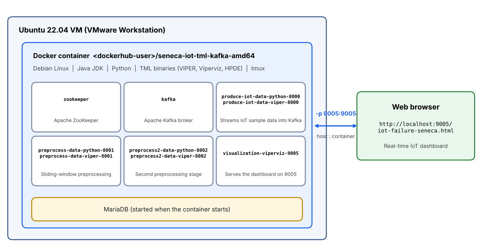

# 🗺️ Architecture

This document describes how the pieces of the lab fit together.

> The diagram is drawn for this repository. The Docker Hub ID is shown as `<dockerhub-user>`.

---

## Components

| Component | Role | Notes |
|-----------|------|-------|
| Ubuntu 22.04 VM | Docker host | VMware Workstation, browser for the dashboard |
| Docker Engine | Runs the container | Installed with `docker.io` |
| Container image | `<dockerhub-user>/seneca-iot-tml-kafka-amd64` | Built from the upstream Dockerfile (`CHIP=AMD64`) |
| Apache Kafka, ZooKeeper | Message streaming | Sessions `kafka` and `zookeeper` |
| MariaDB | Database server | Started when the container starts |
| TML scripts | Produce and preprocess IoT data | Sessions on ports 8000, 8001 and 8002 |
| Viperviz | Serves the dashboard | Session `visualization-viperviz-9005` |

---

## Ports

| Port | Where | Purpose |
|------|-------|---------|
| 9005 | Host and container | Dashboard web page (`-p 9005:9005`) |
| 8000 | Container | `produce-iot-data` sessions |
| 8001 | Container | `preprocess-data` sessions |
| 8002 | Container | `preprocess2-data` sessions |

Only 9005 is published to the host.

---

## tmux Sessions

| Session | Purpose |
|---------|---------|
| `zookeeper` | ZooKeeper for Kafka |
| `kafka` | Kafka broker |
| `produce-iot-data-python-8000`, `produce-iot-data-viper-8000` | Produce the IoT data |
| `preprocess-data-python-8001`, `preprocess-data-viper-8001` | First preprocessing stage |
| `preprocess2-data-python-8002`, `preprocess2-data-viper-8002` | Second preprocessing stage |
| `visualization-viperviz-9005` | Dashboard server |

---

## Design Notes

- **Image name:** The upstream image is `maadsdocker/seneca-iot-tml-kafka-amd64`. Your own image keeps the repository name and swaps the Docker Hub ID.
- **Chip argument:** `CHIP=AMD64` matches an x86-64 VM. Other chips need a different value and a matching image.
- **Docker socket permission:** `sudo chmod 666 /var/run/docker.sock` lets any user on the VM run Docker commands. It is a convenience for a lab VM. Adding the user to the `docker` group is the safer alternative.
- **Warm-up time:** The dashboard needs a few minutes of streaming before data appears.
- **Container IDs:** Container IDs and names change on each `docker run`, so use `docker ps` to read the current one before `docker exec`.
